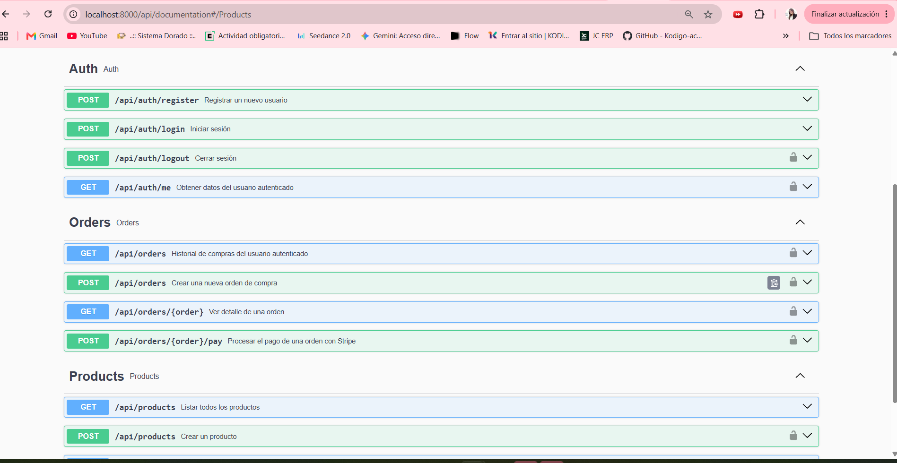
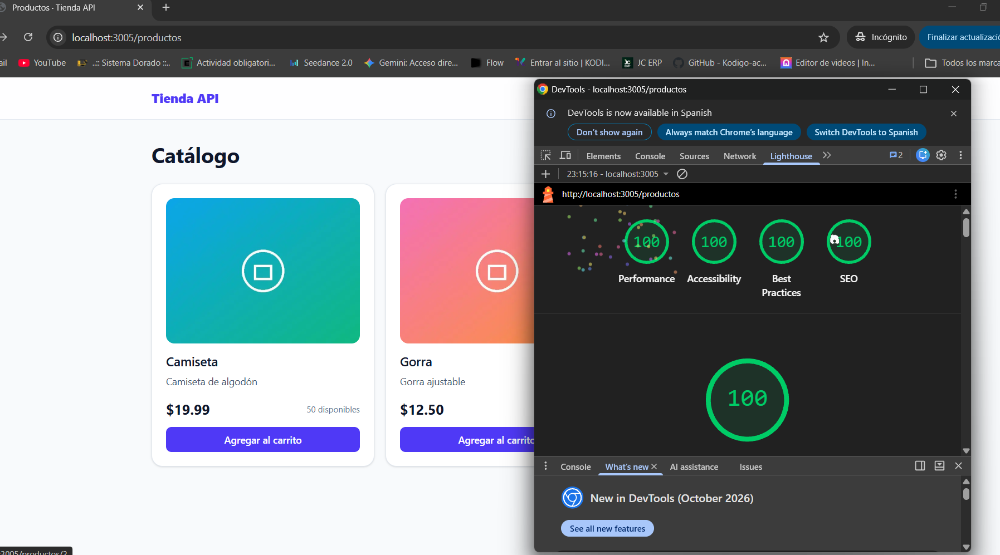
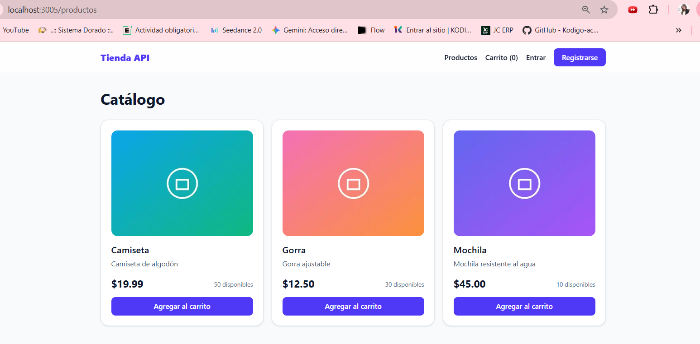
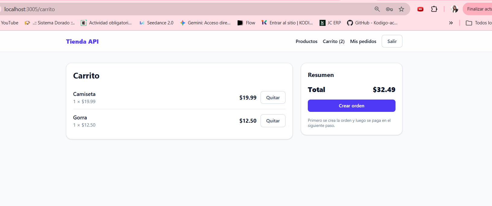
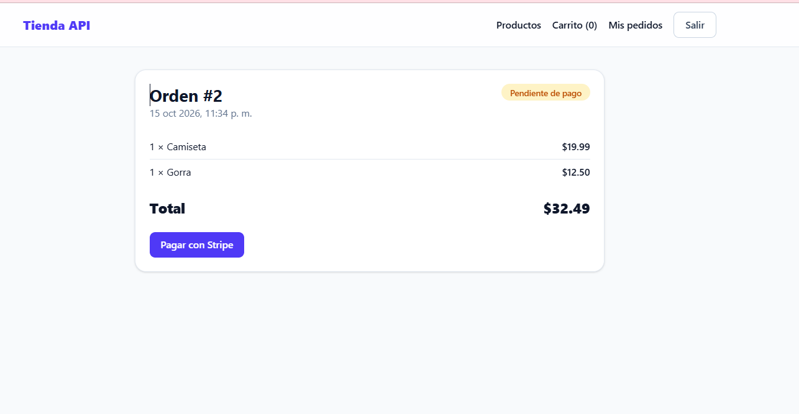
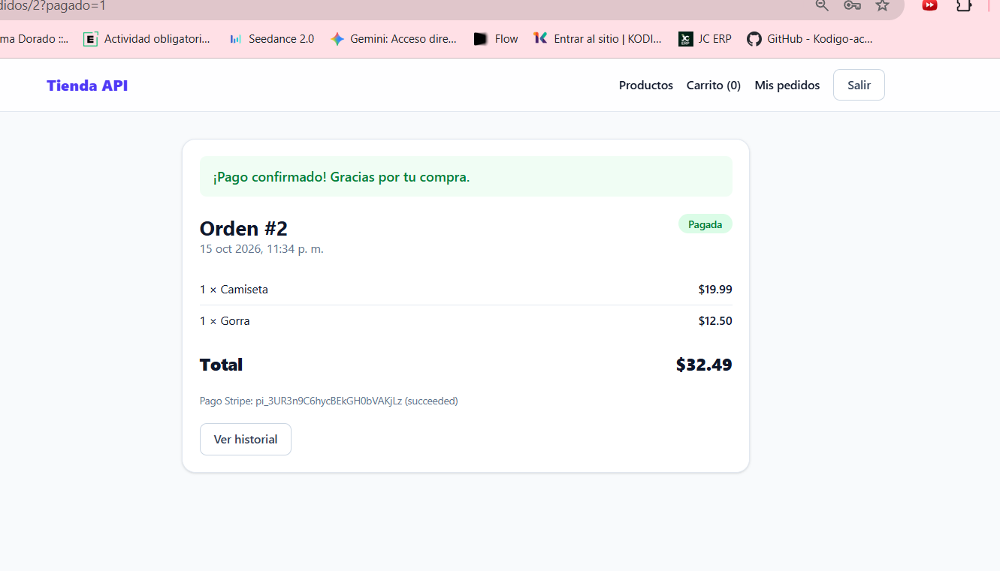
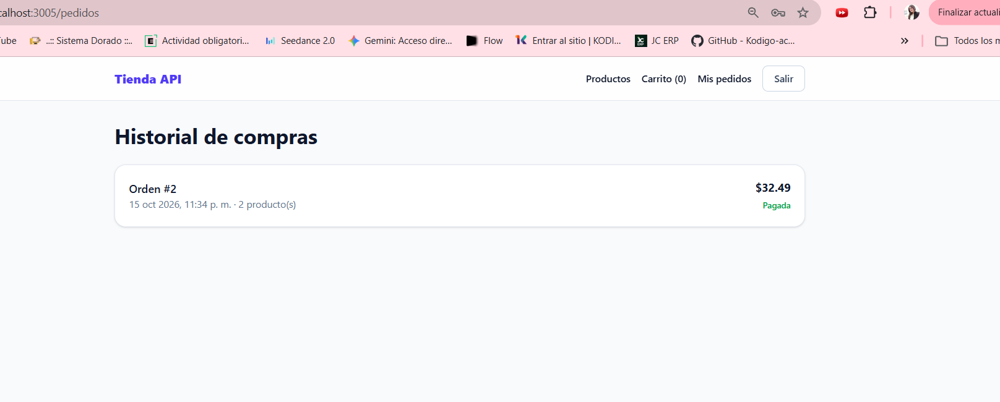

# Tienda API — Frontend Next.js

E-commerce en **Next.js 16 (App Router, TypeScript, Tailwind)** que consume la API Laravel
[`ecommerce-api-swagger`](https://github.com/marcelaarevalom-jpg/ecommerce-api-swagger)
(JWT + Swagger + Stripe).

## Requisitos
- Node 20+
- La API Laravel corriendo (`php artisan serve` → `http://localhost:8000`)

## Variables de entorno
Copia `.env.example` a `.env.local`:

```
BASE_URL=http://localhost:8000/api
```

## Cómo correrlo
```bash
npm install
npm run dev          # desarrollo → http://localhost:3000
# o producción:
npm run build && npm start
```

### API Laravel (en su propia carpeta)
```bash
composer install
cp .env.example .env      # configura DB_*, JWT_SECRET (php artisan jwt:secret) y STRIPE_SECRET (clave sk_test_...)
php artisan key:generate
php artisan migrate
php artisan serve         # http://localhost:8000
```
Swagger: `http://localhost:8000/api/documentation`. Crea productos con `POST /api/products`.

> ¿Sin Laravel a la mano? `npm run mock` levanta una API simulada con los mismos endpoints en el puerto 8000.

## Rutas
| Ruta | Qué hace | Acceso |
|---|---|---|
| `/productos` | Catálogo (Server Component + Suspense + `loading.tsx`) | público |
| `/productos/[id]` | Detalle del producto, `generateMetadata`, `notFound()` | público |
| `/registro`, `/login` | Formularios con Server Actions + Zod + `useActionState` | público |
| `/carrito` | Carrito (cookie), crear orden | protegida |
| `/pedidos` | Historial de compras (`force-dynamic`) | protegida |
| `/pedidos/[id]` | Detalle de orden + pago con Stripe + confirmación | protegida |

## Flujo de compra
registro/login → catálogo → agregar al carrito → **Crear orden** (`POST /orders`) → **Pagar con Stripe** (`POST /orders/{id}/pay`) → confirmación → aparece en el historial.

## Endpoints de la API que se usan
`POST /auth/register`, `POST /auth/login`, `POST /auth/logout`, `GET /products`, `GET /products/{id}`, `GET /orders`, `GET /orders/{id}`, `POST /orders`, `POST /orders/{id}/pay`.

## Conceptos de la clase aplicados
- **Mutaciones asíncronas en el servidor:** `src/app/actions/*.ts` (`'use server'`): login, registro, logout, agregar/quitar del carrito, crear orden, pagar.
- **Validación con Zod:** `src/lib/schemas.ts` + `safeParse` en cada action.
- **Refresco de datos:** `revalidatePath` después de cada mutación.
- **Sesión:** el JWT se guarda en cookie `httpOnly` (`token`); el navegador nunca lo lee. `src/proxy.ts` (antes `middleware.ts`) protege `/carrito` y `/pedidos`.
- **Estados de carga y error:** `loading.tsx` (skeletons), `error.tsx` (botón Reintentar con `retry`/`reset`), `not-found.tsx`, `<Suspense>` en catálogo, historial y header.
- **Rendimiento / Web Vitals:** Server Components por defecto (casi nada de JS en cliente), fuente del sistema (sin descargas), sin imágenes pesadas, `fetch` con `revalidate` y tags, `cache()` de React, metadata por página.

## Capturas

### Swagger (API Laravel)


### Lighthouse (Desktop: 100 / 100 / 100 / 100)


Reporte completo: [lighthouse-desktop.html](docs/lighthouse-desktop.html)

### Flujo de compra
**1. Catálogo**


**2. Carrito**


**3. Orden creada**


**4. Pago confirmado con Stripe**


**5. Historial de compras**


## Notas de diseño
- **Carrito:** vive en una cookie (persistente 7 días) que solo modifican Server Actions; después de cada cambio se llama `revalidatePath`, así el contador del header nunca queda desactualizado.
- **Imágenes:** la API no guarda fotos; se usan 3 imágenes de ejemplo servidas con `next/image` (AVIF/WebP, tamaño fijo para CLS 0, `priority` en las primeras).
- **Paginación:** `/productos?page=N` (6 por página) resuelta en el servidor.
- **Resiliencia:** `loading.tsx` en catálogo, carrito y pedidos; `error.tsx` con botón *Reintentar* en catálogo, carrito y pedidos.
